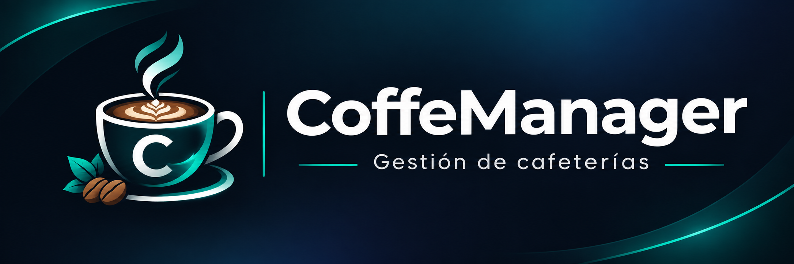
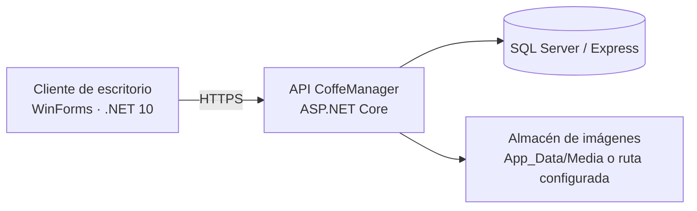

<div align="center">



# ☕ CoffeManager

### Gestión de cafeterías y reposterías · Cliente de escritorio + API + SQL Server

**Proyecto académico de Ingeniería de Software · Metodología XP · 2026**

[](https://dotnet.microsoft.com/)


[**Tablero XP**](https://github.com/users/zorrodev94/projects/1) · [**Historias e incidencias**](https://github.com/zorrodev94/CoffeManager/issues) · [**Historial de cambios**](https://github.com/zorrodev94/CoffeManager/commits/master)

</div>

---

## ¿Qué es CoffeManager?

**CoffeManager** es un sistema en desarrollo para apoyar la administración de cafeterías y negocios de repostería. Su arquitectura separa el cliente de escritorio de la API y de la persistencia: **el cliente se comunica con la API; no se conecta directamente a SQL Server**.

El proyecto se desarrolla de manera incremental mediante **Extreme Programming (XP)**, con historias de usuario, pruebas y evidencia de cada iteración.

> **Estado del proyecto:** prototipo funcional en entorno local. No representa una versión comercial lista para producción.

## Vista general



## Funcionalidades

| Área | Estado | Alcance actual |
|---|---|---|
| Activación inicial | Implementación disponible | Primera cuenta del propietario mediante clave de activación |
| Acceso y sesiones | Implementación disponible | Inicio y cierre de sesión a través de la API |
| Registro autorizado | Implementación disponible | Autorización del propietario para crear otras cuentas |
| Administración inicial | Implementación disponible | Panel de bienvenida y navegación principal |
| Perfil de usuario | En mejora | Visualización, edición y recursos visuales del perfil |
| Roles y asignaciones | En verificación | Asignación de cuenta, empleado, rol y sucursal |
| Negocio, sucursales y empleados | Desarrollo incremental | Pantallas y operaciones que se completan por iteración |
| Inventario, Caja y suscripciones comerciales | Pendiente de completar | No se presentan como módulos terminados |

**Importante:** un formulario visible o una estructura de datos existente no implica que toda su funcionalidad esté finalizada. Los criterios de aceptación y las pruebas se controlan en GitHub Issues.

## Arquitectura del repositorio

```text
CoffeManager/
├── CoffeManager.slnx
├── CoffeManager.csproj            # Servidor / API
├── CoffeManager.Client.Admin/     # Cliente de escritorio
├── Infrastructure/                # API, persistencia y scripts SQL
├── Models/                        # Modelos y repositorios
├── Scripts/                       # Configuración local
├── Tests/                         # Pruebas y verificaciones
├── docs/                          # Configuración, arquitectura, pruebas y assets
├── CHANGELOG.md                    # Cambios por versión
├── LICENSE                        # Derechos reservados
└── README.md
```

## Documentación

- [Configuración local](docs/configuration.md)
- [Arquitectura y mapa de estudio](docs/architecture.md)
- [Pruebas y defectos pendientes](docs/testing.md)
- [Historial de cambios](CHANGELOG.md)

## Puesta en marcha local

**Requisitos:** Windows, .NET 10 SDK, Visual Studio con desarrollo de escritorio .NET, y SQL Server/Express. La API y SQL Server se prueban en el mismo equipo durante el recorrido inicial.

1. **Consultar [configuración local](docs/configuration.md)**. Si ya tienes base y Owner, pasa al paso 6; no repitas configuración ni activación.
2. Si aún no existe la base de datos, crear **`CoffeManager`** mediante `Infrastructure/Database/Scripts/000_create_database.sql` en SSMS.
3. Configurar la conexión local y el secreto de activación, **solo si no se configuraron anteriormente**:

   ```powershell
   .\Scripts\Configure-Local.ps1
   ```

4. Para una instalación nueva, inicializar el esquema versionado (incluida la migración `002`):

   ```powershell
   dotnet run --project CoffeManager.csproj --launch-profile https -- --initialize-database
   ```

5. Verificar el esquema real:

   ```powershell
   dotnet run --project CoffeManager.csproj --launch-profile https -- --verify-database
   ```

6. Iniciar la API y, desde otra terminal, el cliente:

   ```powershell
   dotnet run --project CoffeManager.csproj --launch-profile https
   ```

   ```powershell
   dotnet run --project CoffeManager.Client.Admin/CoffeManager.Client.Admin.csproj
   ```

La API de desarrollo utiliza `https://localhost:7066`. **Si ya hay un propietario y conexión configurada, no regeneres la clave, no borres la base y no repitas la activación inicial.**

> No publiques claves de activación, contraseñas, secretos, fotografías privadas ni copias de bases de datos en el repositorio. `TrustServerCertificate=True` se reserva al SQL local de desarrollo y no sustituye una configuración de producción.

## Galería de la aplicación

**Capturas por incorporar:** inicio de sesión, autorización de registro, panel de administración y perfil profesional. Se añadirán imágenes recortadas de la aplicación, sin correos personales, contraseñas o información privada.

<!-- Cuando existan capturas revisadas, guardarlas en docs/screenshots/ y enlazarlas aquí. -->

## Desarrollo con XP

El trabajo se organiza en **iteraciones**, no en sprints Scrum. Las historias y tareas técnicas pasan por **Backlog → Por hacer → En desarrollo → En pruebas → Terminado**.

- **Iteración 1:** acceso, activación, registro autorizado y panel inicial; implementación publicada. La evidencia formal QA-01 sigue pendiente.
- **Iteración 2:** mejora visual y funcional del perfil, validaciones, persistencia de imágenes y pruebas de interfaz.

Las aportaciones se registran según el trabajo efectivamente realizado: implementación, pruebas, análisis, documentación y revisión. Los commits no sustituyen las evidencias de pruebas.

➡️ **[Abrir el tablero CoffeManager | XP Agile Development](https://github.com/users/zorrodev94/projects/1)**

## Evidencia y contribuciones

- [Issues / historias de usuario](https://github.com/zorrodev94/CoffeManager/issues)
- [Commits de la rama master](https://github.com/zorrodev94/CoffeManager/commits/master)
- [Cambios por versión](CHANGELOG.md)
- [Pruebas y defectos pendientes](docs/testing.md)

## Estado y alcance

Este repositorio es un **proyecto académico en evolución** con posibles aplicaciones comerciales futuras. Su código, diseño y documentación están sujetos a revisiones.

### Derechos de autor y uso

**Copyright © 2026 Christopher Díaz Gastélum · ZDesarrollo Virtual. Todos los derechos reservados, en el alcance de los derechos que correspondan legalmente a su titular.**

El proyecto es **software propietario** y no concede una licencia general de reutilización, modificación, redistribución o explotación comercial. Su publicación en GitHub no elimina los permisos y excepciones legales ni los derivados de los términos de la plataforma. Los materiales de terceros mantienen sus propias licencias y titularidad.

Consulta el aviso completo en **[LICENSE](LICENSE)**. Una futura licencia comercial para clientes se documentará por separado.

<div align="center"><sub>CoffeManager · ZDesarrollo Virtual · 2026</sub></div>
